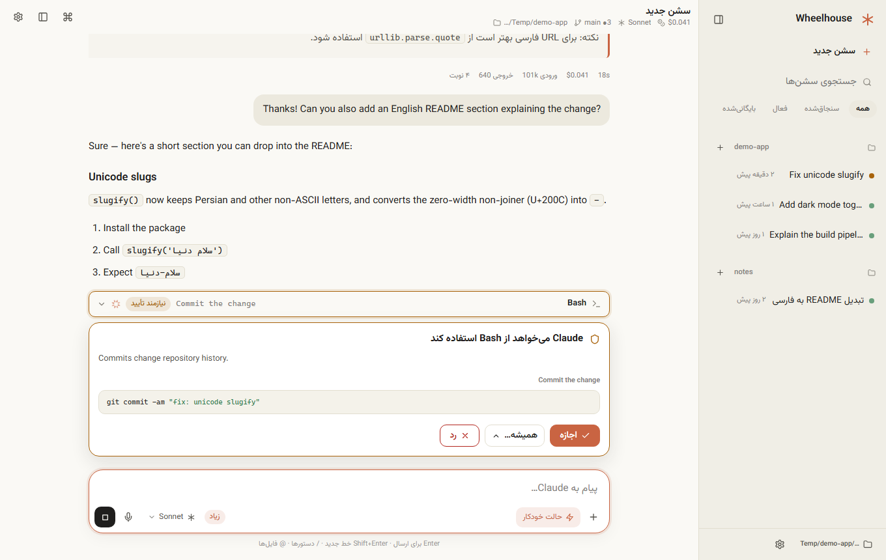

<div dir="rtl">

<h1 align="center">Wheelhouse</h1>

<p align="center">
  <strong>یک رابط گرافیکی حرفه‌ای و دسکتاپ‌مانند برای Claude Code.</strong><br>
  روی سیستم خودتان اجرا می‌شود، داخل مرورگر یا در یک پنجرهٔ مستقل، با پشتیبانی کامل از راست‌به‌چپ.
</p>

<p align="center"><a href="README.md">English</a></p>

<p align="center">
  
</p>

Wheelhouse یک رابط گرافیکی روی **خود فایل اجرایی Claude Code** است و چیزی را از نو پیاده‌سازی نمی‌کند. با
[Claude Agent SDK](https://code.claude.com/docs/en/agent-sdk/overview) کار می‌کند؛ پس سشن‌ها، تنظیمات، skillها، سرورهای
MCP، افزونه‌ها، hookها و دسترسی‌ها دقیقاً مثل ترمینال رفتار می‌کنند و پیکربندی فعلی شما همان‌طور که هست کار می‌کند.
Wheelhouse هیچ‌وقت خودش با API مدل صحبت نمی‌کند و هیچ درخواستی را دست‌کاری نمی‌کند.

> Wheelhouse یک پروژهٔ مستقل و متن‌باز است و ارتباطی با Anthropic ندارد؛ «Claude» و «Claude Code» نشان تجاری Anthropic هستند.

## چرا

- **یک محیط کار واقعی، نه فقط ترمینال:** گفتگو، diff، تأیید دسترسی‌ها، کارها، git و فایل‌ها کنار هم.
- **اتصال دلخواه شما:** با یک فایل پیکربندی کوچک و «پروفایل»‌های قابل‌تعویض، به هر نصب Claude Code، wrapper،
  گیت‌وی، کلید API، Bedrock یا Vertex وصل می‌شود ([راهنما](docs/CONFIGURATION.md)).
- **راست‌به‌چپ درست:** متن فارسی و عربی که با انگلیسی و کد قاطی است همه‌جا درست نمایش داده می‌شود: جهت هر بلوک جدا،
  چیدمان منطقی، ارقام فارسی. کاربران چپ‌به‌راست همین تجربه را آینه‌ای می‌گیرند. رابط فارسی و انگلیسی دارد و افزودن زبان
  تازه ساده است.
- **محلی و خصوصی:** سرور فقط روی `127.0.0.1` گوش می‌دهد، مبدأ هر درخواست را بررسی می‌کند و حساب کاربری لازم ندارد.

## امکانات

- پاسخ زنده با Markdown، جدول، کد رنگی، «فکر کردن» جمع‌شونده و کارت ابزارها (Bash، diff ویرایش، خواندن، جستجو، وب،
  زیرعامل‌ها، MCP).
- تأیید دسترسی (یک‌بار / همیشه / رد با دلیل)، فرم سؤال، بازبینی برنامه، تصویر، `@فایل`، دستورهای `/`، صف پیام، توقف،
  انشعاب و بازگرداندن فایل‌ها.
- انتخاب مدل، effort و تفکر از فهرست واقعی مدل‌های حساب شما؛ حالت‌های دسترسی: بپرس، پذیرش ویرایش‌ها، برنامه‌ریزی،
  خودکار، نپرس و (با فعال‌سازی صریح) دور زدن.
- سشن‌ها بر اساس پروژه، با جستجو، سنجاق، بایگانی، تغییر نام و ادامه. سشنِ «پوشهٔ جدید» خودکار پوشهٔ جدا می‌گیرد.
- پنل‌ها: تغییرات (git)، فایل‌ها، ترمینال، Context، مصرف، کارها، فعالیت و نقطه‌های بازگشت.
- تنظیمات بدون ویرایش دستی: دسترسی‌ها، متغیرهای محیطی، hookها، حافظه (`CLAUDE.md`)، سبک خروجی، MCP، افزونه‌ها،
  skillها، دستورها، ایجنت‌ها و `settings.json`.

فهرست کامل (از جمله آنچه ساخته نشده) در [docs/FEATURES.md](docs/FEATURES.md) است.

## شروع سریع

پیش‌نیاز: **Node.js 20+** و Claude Code روی سیستم شما (نصب و وارد شده، یا از طریق پروفایل تنظیم شده). اگر `claude`
پیدا نشود، فایل اجرایی همراه SDK استفاده می‌شود.

```bash
git clone https://github.com/msmahdinejad/claude-code-gui.git
cd claude-code-gui
npm install
npm start -- --open        # یا: npm start -- --app  (پنجرهٔ مستقل با Chrome/Edge)
```

سپس <http://127.0.0.1:4173> را باز کنید. پرچم‌ها: `--port`، `--config`، `--cwd`، `--data-dir`، `--tray`.

در ویندوز با `--tray` یک آیکن در ناحیهٔ اعلان‌ها (کنار ساعت) می‌ماند: با کلیک پنجرهٔ برنامه باز می‌شود، با راست‌کلیک منوی باز کردن / باز کردن در مرورگر / اجرا همراه ویندوز / خروج کامل را می‌بینید، و شورتکات‌های سراسری `Ctrl+Alt+W` (پنجرهٔ برنامه) و `Ctrl+Alt+Shift+W` (مرورگر) کار می‌کنند. خروج کامل هم از منوی آیکن و هم از پالت دستورها («Quit Wheelhouse») ممکن است.

### اتصال به Claude Code خودتان

بدون پیکربندی، `claude` از `PATH` اجرا می‌شود و از ورود فعلی شما استفاده می‌کند. برای هر حالت دیگر فایل
`wheelhouse.config.json` (یا `~/.wheelhouse/config.json`) بسازید:

```jsonc
{
  "defaultProfile": "gateway",
  "defaults": { "model": "sonnet", "permissionMode": "auto", "effort": "high" },
  "profiles": {
    "gateway": {
      "label": "گیت‌وی شرکت",
      "command": "claude",
      "configDir": "~/.claude-gateway",
      "env": {
        "ANTHROPIC_BASE_URL": "https://llm-gateway.example.com",
        "ANTHROPIC_CUSTOM_HEADERS": "X-Api-Key: ${GATEWAY_KEY}"
      }
    }
  }
}
```

پروفایل‌ها را در **تنظیمات ← اتصال** عوض و تست کنید. نمونه‌های آماده در [`examples/`](examples) و مرجع کامل در
[docs/CONFIGURATION.md](docs/CONFIGURATION.md) هستند.

## توسعه و مشارکت

```bash
npm install
npm run check      # eslint + تست‌ها + پوشش ترجمه
```

فرانت‌اند ماژول‌های ES ساده و بدون مرحلهٔ build است. هر قابلیت یک ماژول مستقل در `web/js/features/` است. راهنما:
[CONTRIBUTING.md](CONTRIBUTING.md) و [docs/ARCHITECTURE.md](docs/ARCHITECTURE.md). امنیت: [SECURITY.md](SECURITY.md).

## مجوز

[MIT](LICENSE)

</div>
