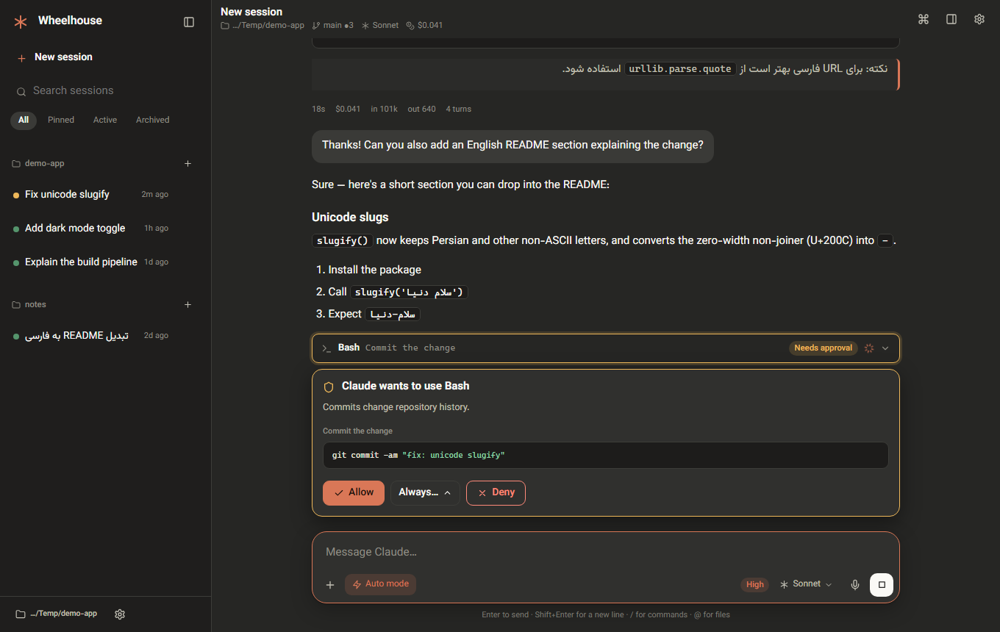
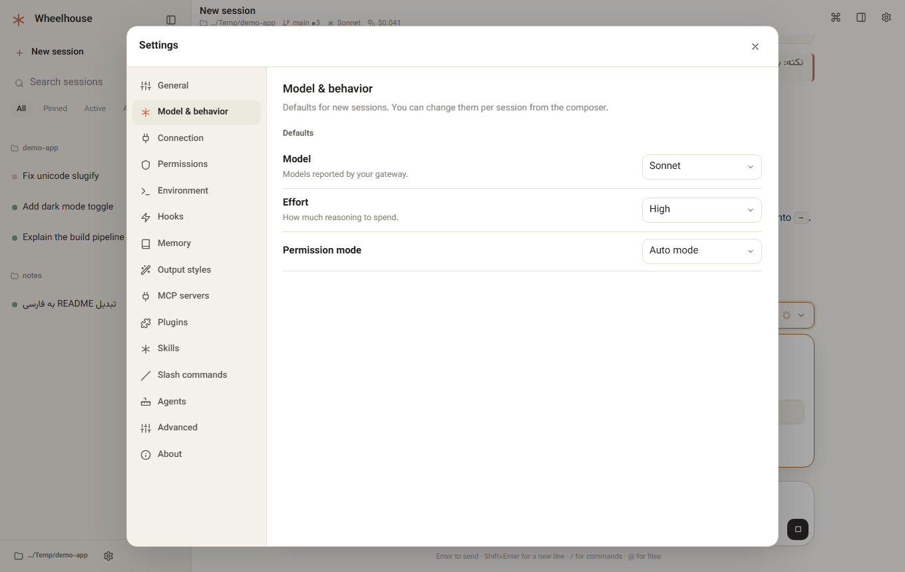

<h1 align="center">Claude Code GUI<br><sub>Wheelhouse</sub></h1>

<p align="center">
  <strong>A desktop-class graphical interface for Claude Code.</strong><br>
  Runs on your machine, in your browser or as a standalone window, with first-class right-to-left support.
</p>

<p align="center">
  <a href="https://github.com/msmahdinejad/claude-code-gui/actions/workflows/ci.yml"></a>
  <a href="LICENSE"></a>
  
  <a href="CONTRIBUTING.md"></a>
  <a href="README.fa.md"></a>
</p>

<p align="center">
  
</p>

Wheelhouse puts a polished interface on top of the **real Claude Code executable**. Nothing is re-implemented: it drives
the official [Claude Agent SDK](https://code.claude.com/docs/en/agent-sdk/overview), so sessions, settings, skills, MCP
servers, plugins, hooks and permissions behave exactly as they do in the terminal, and your existing configuration just
works. It never talks to the model API itself and never alters a request.

> Wheelhouse is an independent, community project. It is not affiliated with, endorsed by or sponsored by Anthropic.
> "Claude" and "Claude Code" are trademarks of Anthropic, PBC.

## Why

- **A real workspace, not a terminal.** Conversations, diffs, approvals, tasks, git and files side by side.
- **Bring your own connection.** Point it at any Claude Code installation, wrapper script, gateway, API key, Bedrock or
  Vertex through a small config file with switchable [profiles](docs/CONFIGURATION.md).
- **Right-to-left done properly.** Persian and Arabic text, mixed with English and code, renders correctly everywhere:
  per-block direction, logical layout, native digits. Left-to-right users get the mirror image. The UI ships in English
  and Persian and is easy to extend.
- **Local and private.** The server binds to `127.0.0.1`, checks the origin of every request and needs no account.

## Features

**Conversation**
- Streaming replies with Markdown, tables, syntax-highlighted code, collapsible thinking and rich tool cards (Bash,
  Edit/Write diffs, Read, search, web, tasks, sub-agents, MCP).
- Approval prompts with *allow once / always allow… / deny with a reason*, question forms, plan review, MCP elicitations.
- Images (paste, drag, attach), `@file` mentions, `/` commands and skills, message queue, interrupt, fork and rewind.

**Control**
- Model, effort and extended-thinking picker fed by your account's real model list, switchable mid-session.
- Permission modes: ask, accept edits, plan, auto, don't ask, and (opt-in) bypass.
- Sessions grouped by project, searchable, pinnable, renameable, resumable. **New folder** sessions get their own folder
  automatically, like the desktop app.

**Workspace panels**
- **Changes**: stage, commit, branches, history, unified/split diffs. **Files**: tree, preview, edit, `@`-reference.
  **Terminal**: streamed command runner. **Context**, **Usage**, **Tasks**, **Activity**, **Checkpoints**.

**Configuration, no hand-editing required**
- Permissions, environment, hooks, memory (`CLAUDE.md`), output styles, MCP servers, plugins, skills, slash commands,
  agents and the raw `settings.json`, per user / project / local scope.

See [docs/FEATURES.md](docs/FEATURES.md) for the full coverage table, including what is not built.

<p align="center">
  
  
</p>

## Quick start

Requirements: **Node.js 20+** and Claude Code available on your machine (installed and signed in, or configured through
a profile). If no `claude` executable is found, the binary bundled with the Agent SDK is used.

```bash
git clone https://github.com/msmahdinejad/claude-code-gui.git
cd claude-code-gui
npm install
npm start -- --open        # or: npm start -- --app   (standalone window via Chrome/Edge)
```

Then open <http://127.0.0.1:4173>. Useful flags: `--port`, `--config`, `--cwd`, `--data-dir` (see `wheelhouse --help`).

To run it from anywhere, `npm link` inside the checkout puts a `wheelhouse` command on your `PATH`.

### Connect it to *your* Claude Code

With no configuration Wheelhouse runs `claude` from your `PATH` and uses your existing login. For anything else, create
`wheelhouse.config.json` (or `~/.wheelhouse/config.json`):

```jsonc
{
  "defaultProfile": "gateway",
  "defaults": { "model": "sonnet", "permissionMode": "auto", "effort": "high" },
  "profiles": {
    "gateway": {
      "label": "Company gateway",
      "command": "claude",                         // any executable that speaks Claude Code's protocol
      "configDir": "~/.claude-gateway",            // keeps sessions/settings separate
      "env": {
        "ANTHROPIC_BASE_URL": "https://llm-gateway.example.com",
        "ANTHROPIC_CUSTOM_HEADERS": "X-Api-Key: ${GATEWAY_KEY}"   // secrets stay in your environment
      }
    }
  }
}
```

Switch profiles any time in **Settings → Connection**, which also tests them. Ready-made examples for gateways, API
keys, Bedrock, Vertex and wrapper scripts are in [`examples/`](examples); the full reference is
[docs/CONFIGURATION.md](docs/CONFIGURATION.md).

## Keyboard

| | |
|---|---|
| `Enter` / `Shift+Enter` | Send / new line (switchable to `Ctrl+Enter`) |
| `Esc` | Stop the current response |
| `/` · `@` | Commands and skills · file mentions |
| `Ctrl+K` | Command palette |
| `Ctrl+B` · `Ctrl+.` | Toggle sidebar · inspector |
| `Ctrl+Shift+O` · `Ctrl+,` | New session · settings |
| `Ctrl+F` | Find in conversation |

## How it works

```
 Browser UI  ⇄  Wheelhouse server (127.0.0.1)  ⇄  Claude Agent SDK  ⇄  claude (your executable)  ⇄  your model provider
```

The server keeps one long-lived `claude` process per active session and forwards its messages to the browser untouched;
the UI folds them into a conversation model. Details and extension points: [docs/ARCHITECTURE.md](docs/ARCHITECTURE.md).
Security model and hardening notes: [SECURITY.md](SECURITY.md).

## Development

```bash
npm install
npm run check      # eslint + tests + translation coverage
npm run dev        # restart the server on changes (the web app needs only a reload)
```

The front end is plain ES modules with no build step. The only generated file is `web/vendor/md.js`
(`npm run build:vendor`). Features are self-contained modules dropped into `web/js/features/`; see
[CONTRIBUTING.md](CONTRIBUTING.md) and [docs/ARCHITECTURE.md](docs/ARCHITECTURE.md). Translations live in
`web/js/i18n/<lang>/`; adding a language is one file per feature area.

## Status

Early (`0.x`): usable day to day, and the file layout and config format may still change between minor versions.
Known limitations are listed in [docs/FEATURES.md](docs/FEATURES.md).

## License

[MIT](LICENSE). Third-party components and their licenses: [THIRD_PARTY_NOTICES.md](THIRD_PARTY_NOTICES.md).
