# Feature guide

What Wheelhouse can do beyond a chat window, and how to turn each thing on. Every screenshot comes from a throwaway
demo workspace (a made-up project in an empty folder), so nothing in them is a real project or account.

Contents: [Updates](#updating-claude-code) · [All settings](#every-claude-code-setting) · [Memory](#memory-claudemd-rules-auto-memory) ·
[Shortcuts, themes, environment](#keyboard-shortcuts-themes-environment-diagnostics) · [Scheduled tasks](#scheduled-tasks) ·
[Conversation](#the-conversation) · [Message box](#the-message-box) · [Terminal and preview](#real-terminal-and-preview) ·
[Split view](#split-view) · [Git](#git-and-worktrees) · [Resume after restart](#resume-after-a-restart) ·
[Limit resets](#limit-resets) · [Not available](#what-is-not-available)

## Updating Claude Code

Claude Code only knows the models and features that existed when it was built, so keeping it current matters. When a
newer version is published, a chip next to the title says so, whether or not automatic updates are on.

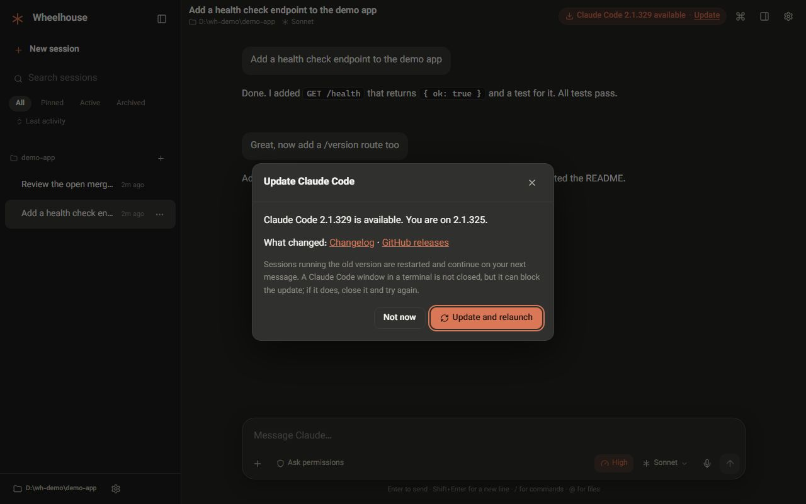

1. Click the chip *Claude Code X available · Update*.
2. *Update and relaunch* downloads the new version with a progress bar. Sessions running the old version are restarted
   and continue on your next message.

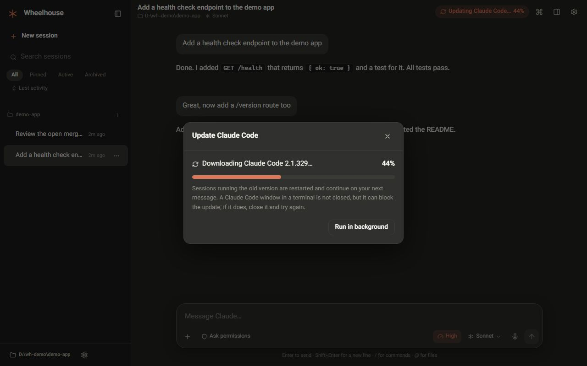

**Automatic updates** are a switch in *Settings → Updates* (on by default for new installs; turn it off if you prefer to
click).

**How it stays safe.** The new version is installed next to the old one, checked (the binary exists, is large enough and
`--version` matches), and only then swapped in by renaming folders. If anything fails, the old version is restored by
renaming back, which needs no network. An interrupted swap is recovered at the next start. A Claude Code window open in
a terminal locks the files on Windows; the dialog then asks you to close it and try again.

## Every Claude Code setting

*Settings* has pages for the keys of the official settings reference, 168 in all: models and responses, terminal and
interface, context/git/privacy, auto mode and sandbox, workflows/skills/MCP, sessions and accounts, plus an
*All Claude Code settings* page with search.

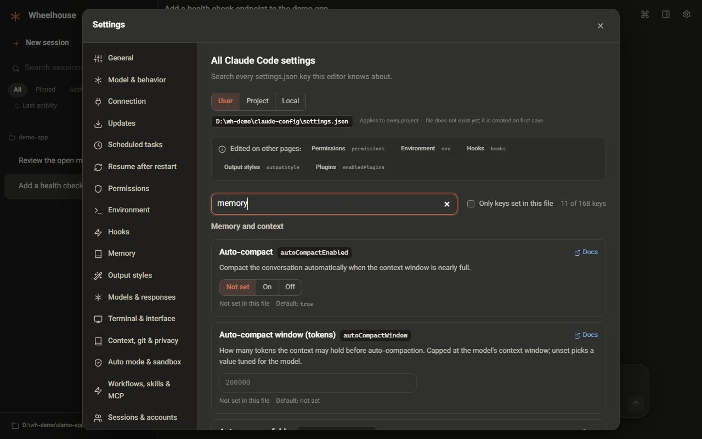

- Switch between **User** (every project), **Project** (committed) and **Local** (just you) at the top.
- Each row shows what the key does, a link to the docs, its documented default, a *Reset* button and a badge when
  another scope or a managed policy also sets it.
- Input is validated against the documented type before it is saved. Only the key you change is written, so unknown
  keys and the rest of the file are left alone. Keys that Claude Code reads only from user settings are locked in
  project/local scope.
- Permissions, hooks, environment, output styles and plugins have their own pages; the settings pages link to them.

## Memory: CLAUDE.md, rules, auto memory

*Settings → Memory* has three tabs because Claude Code has three kinds of memory.

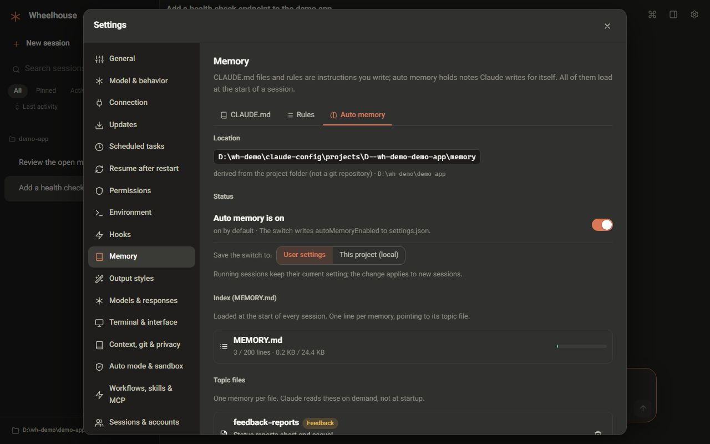
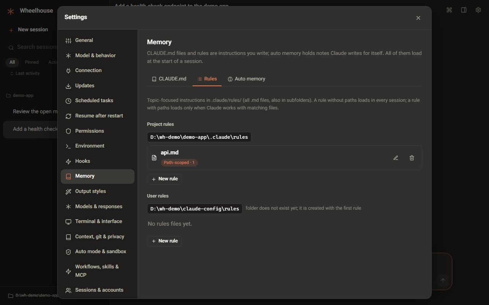

- **CLAUDE.md** (user, project, local): the instructions you write. *Create with /init* asks Claude for a first draft.
- **Rules**: one file per topic in `.claude/rules/`. Add `paths` (for example `src/api/**/*.ts`) and the rule loads only
  when Claude works with matching files.
- **Auto memory**: notes Claude writes for itself. The page finds the project's memory folder the way Claude Code does
  (git root, `autoMemoryDirectory`, `CLAUDE_CODE_PROJECT_DIR_NAME`), shows whether auto memory is on (with a switch), the
  `MEMORY.md` index, and every topic file. Only the first 200 lines / 25 KB of the index load each session, and the
  page warns when you get close. View, edit, create and delete memories; deleting asks first and offers to remove the
  index line too.

## Keyboard shortcuts, themes, environment, diagnostics

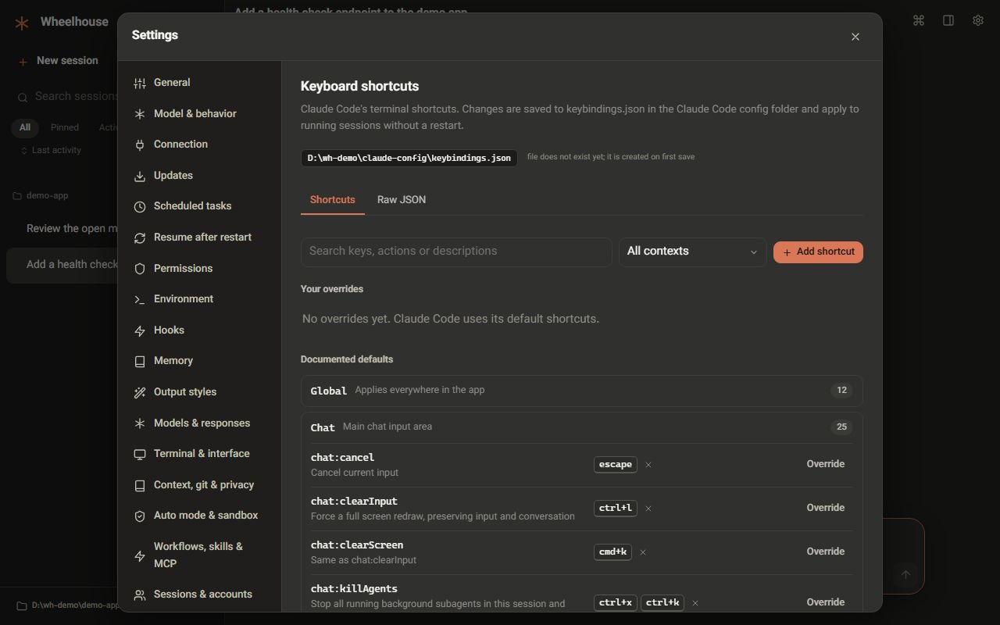
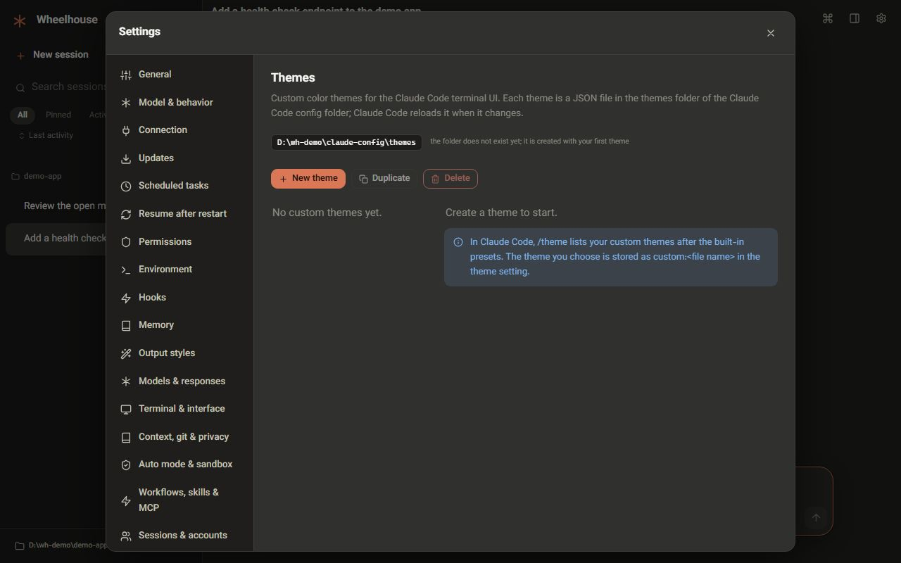

- **Keyboard shortcuts** edits `keybindings.json`: 27 contexts, 145 actions, chord syntax checked, override or unbind
  (`null`). The terminal CLI reads the same file.
- **Themes** edits `themes/*.json`: create, duplicate, edit with swatches and a preview. Select one with `/theme` or
  the `theme` setting.
- **Environment** edits the `env` block of `settings.json` and suggests 349 documented variables with descriptions;
  secrets are masked.
- **Diagnostics** shows the Claude Code version, `claude auth status`, `mcp list`, `doctor`, the executable, profile,
  config folder and the update status in one place.

## Scheduled tasks

Recurring prompts that Wheelhouse starts as sessions, like Claude Desktop's scheduled tasks. They run only while
Wheelhouse is open.

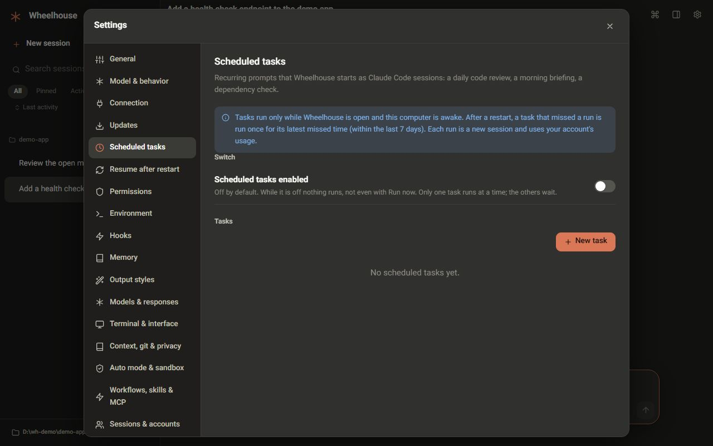

1. *Settings → Scheduled tasks*. The global switch is **off by default**; nothing runs, not even *Run now*, until you
   turn it on.
2. *New task*: name, prompt, folder, frequency (manual, hourly, daily, weekdays, weekly), time, model, permission mode.
3. Try *Run now* on a small read-only task first. Every run is a new session and appears in the session list.

Safety: only `plan` (default), `acceptEdits`, `dontAsk` and `auto` are accepted; bypass and ask-every-time are refused for
unattended runs. One run at a time, at most 40 turns per run (configurable up to 200), a run is stopped after 60
minutes, and a permission request nobody answers within 10 minutes is refused. After a restart a missed run is made up
once (at most 7 days back). The last 50 runs of each task are kept. Each run uses your account's usage.

## The conversation

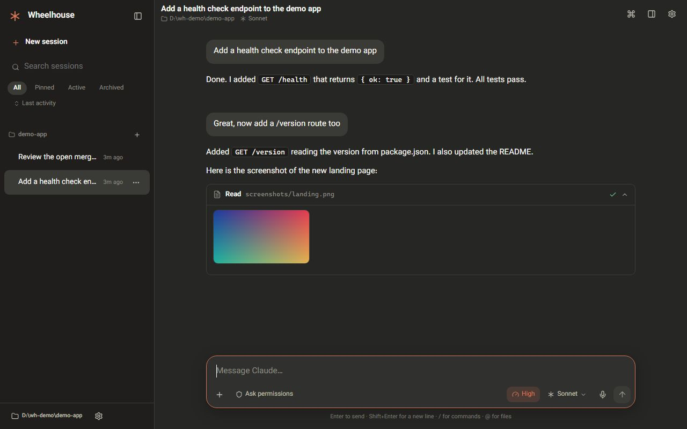

- Images that tools return (Read on a picture, browser screenshots) are shown, with a viewer.
- `/goal` shows a chip with the condition, turn count, last reason and a *Clear* button.
- A refused reply that fell back to another model removes the retracted messages and offers *Edit and retry*.
- API failures are one message that updates in place: the HTTP status in words, the attempt, when the next try
  happens, and whose side the fault is on.
- Background subagents show their real state (running, current step, tools used, time) and a strip under the
  conversation lists everything still running.
- Cards for Workflow, ReportFindings (with *Fix this*), Artifact, PushNotification, SendUserFile and worktree tools.
- PDFs (up to 10 MB) and text/code files (up to 500 KB) can be attached next to images.
- The model picker has *Speed and extras* (fast mode, ultracode, advisor) where the model supports them, and it keeps
  models you used that the CLI does not list (the *Fable* row follows the newest Fable that answered).
- Sessions can carry one tag; filter by tag and sort by activity, creation or name in the sidebar.

## The message box

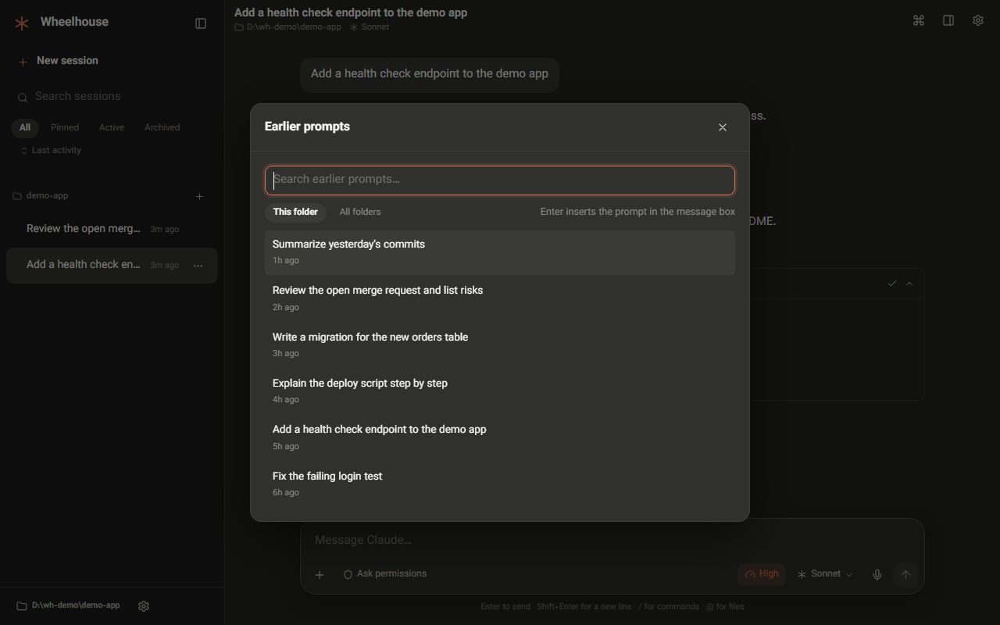
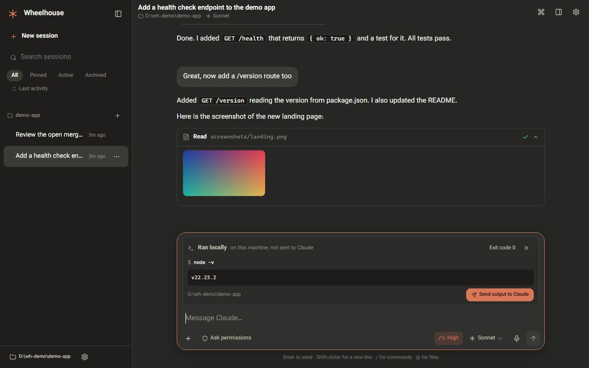

- **`Ctrl+R`** searches the prompts you sent in earlier sessions (read from Claude Code's `history.jsonl`), for this
  folder or all folders. `Enter` puts one in the box.
- **`!` shell mode**: a message starting with `!` runs on this machine in the session's folder and is **not** sent to
  Claude. *Send output to Claude* shares the result when you want to.
- **Continue after a usage limit**: when a claude.ai limit stops a turn, a banner says *Usage limit reached — continue
  automatically at HH:MM* with a switch. It is **on by default**; at the reset time it sends one message asking Claude to
  continue, only if the session is idle and you have not written anything newer, and stops after 3 automatic
  continues in a row. Turn the switch off in the banner to keep control.

## Real terminal and preview

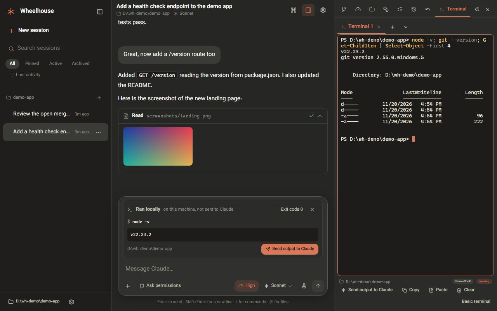

- **Terminal** is a real pseudo-terminal (ConPTY on Windows, via the optional `node-pty` package, with xterm.js):
  colors, history, interactive programs, tabs and a shell chooser (PowerShell, PowerShell 7, Bash, Command Prompt).
  Without `node-pty` the previous basic runner is used and labelled *Basic terminal*. At most 6 terminals; one with
  no viewer and no input for 2 hours is closed.

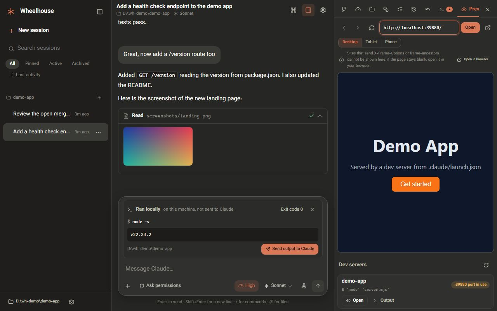

- **Preview** shows a local web app next to the conversation: type a port, or define dev servers in
  `.claude/launch.json` (`name`, `runtimeExecutable`, `runtimeArgs`, `port`) and press *Start* (the first run of a
  command shows it for confirmation). Project HTML and PDF files can be opened too. Device widths: desktop, tablet,
  phone. Only `localhost`/`127.0.0.1` can be framed (a CSP `frame-src` allows nothing else), never Wheelhouse's own
  port, and HTML files run without scripts unless you tick *Allow scripts*.

## Split view

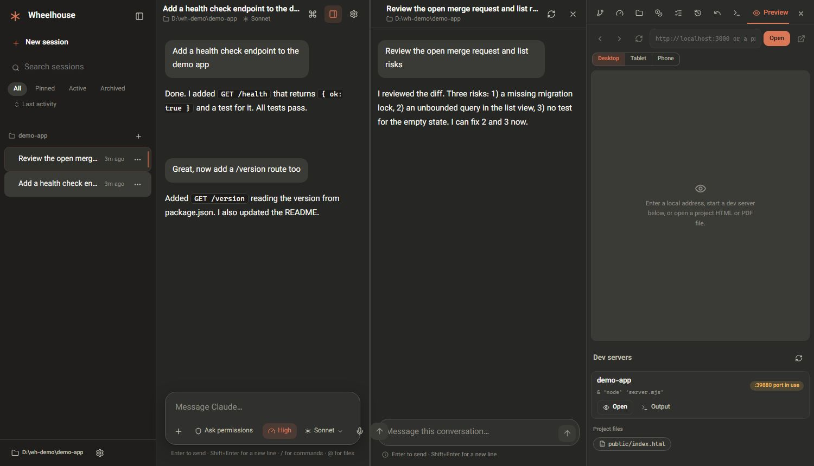

Open a second conversation beside the main one: sidebar session menu → *Open in split view*, or `Alt`+click a session
(window at least 1100 px wide). Drag the divider (double-click resets it). The second pane has its own message box and
Stop button and shows approval/question/plan cards, so a background session can be answered there. *Swap with main*
exchanges the two. Attachments, slash commands and the queue stay in the main message box. Notifications stay quiet
for a conversation you can see in either pane.

## Git and worktrees

In the *Changes* panel: push, pull (fast-forward only) and stash with plain error messages; a pull request card when
the GitHub CLI (`gh`) is installed (status, checks, create, open in the browser); and a list of the repository's git
worktrees, including Claude Code's `.claude/worktrees/`, with size, branch and state and a *Remove* button (a dirty
worktree needs a second confirmation). Arguments are passed to git individually and checked; nothing from your text
goes through a shell.

## Resume after a restart

If Wheelhouse is restarted (an update, a crash, a reboot) while a session is working, that turn is cut off. Wheelhouse
keeps a small list of sessions that are working, so at the next start it can offer to continue them.

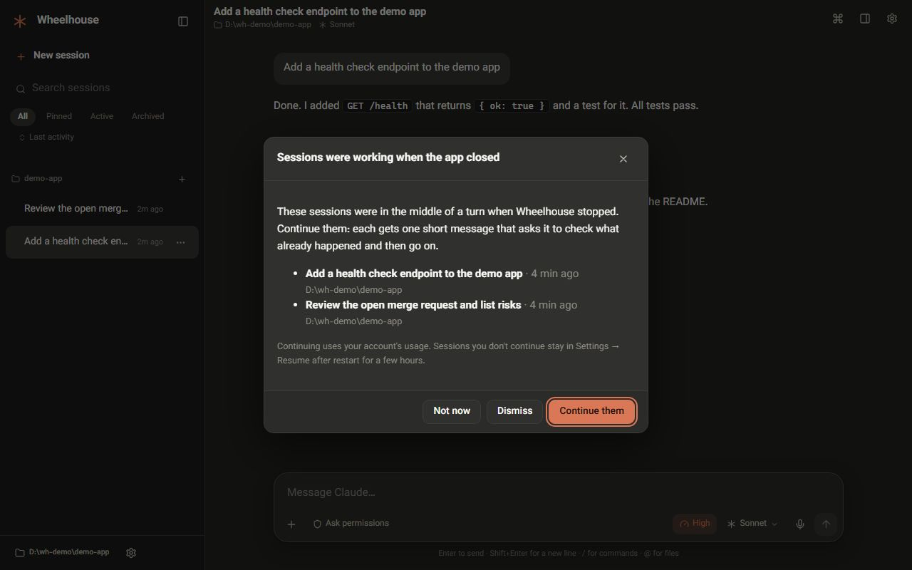
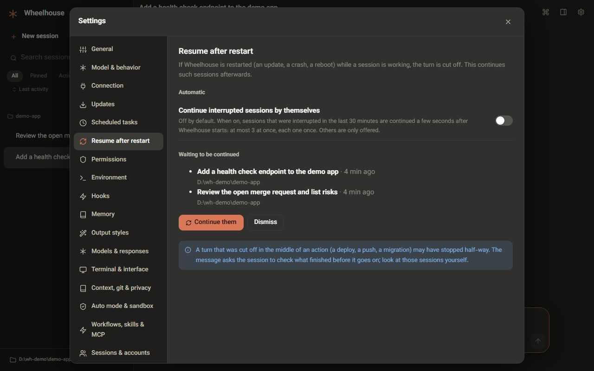

- At start, a dialog lists the interrupted sessions: *Continue them*, *Not now* or *Dismiss*. They stay in
  *Settings → Resume after restart* for a few hours.
- The switch *Continue interrupted sessions by themselves* is **off by default**. When on, sessions interrupted in the
  last 30 minutes are continued a few seconds after start: at most 3, each once. Each gets one message that asks it to
  check what already finished, then go on.
- Scheduled runs are never continued this way, and a session you stopped yourself is not on the list.
- A turn cut off in the middle of a deploy, push or migration may have stopped half-way; look at those sessions.

## Limit resets

The *Reset for free* resets of a claude.ai account can only be used through Claude Code itself. `/limit-reset` (or
*Usage → Limit resets…*) opens Claude Code 2.1.322 or newer in a new terminal window, signed in as the chosen profile,
with `/limit-reset` or `/limit-reset fable|full|5-hour|weekly`. Each button asks first because a reset may be used
right away. Wheelhouse cannot list an account's resets. Resets belong to one account, and Anthropic has not enabled the
command for every plan (it answers *Unknown command* where it is off).

## What is not available

- **MCP resources** (listing and `@server:uri` completion): the Agent SDK offers no way to list them. A hand-typed
  `@server:uri` still reaches Claude Code, which resolves it itself.
- Automatic continue after a usage limit and scheduled tasks were tested against a fake session manager and injected
  events, not with real model calls; try them once on a cheap task.
- `node-pty` has no prebuilt binaries for Linux, where it is compiled on install; if that fails the basic terminal is
  used.
- Preview of an HTML file does not load its relative images and styles.

See [FEATURES.md](FEATURES.md) for the full coverage table and [CONFIGURATION.md](CONFIGURATION.md) for settings.
